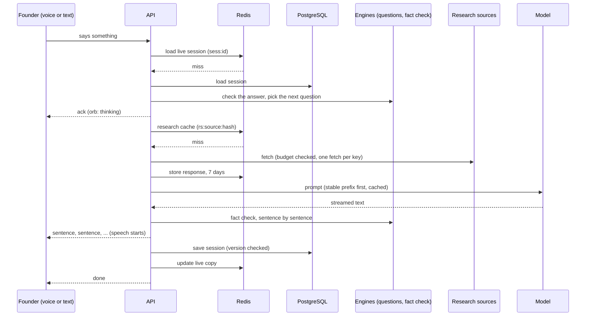

# Vanigam system design: data, memory, caching, database, documentation

**Date:** 2026-10-08
**Status:** design. Says *where* everything lives, *how long* it lives, *who* changes it and
*how* the parts stay consistent. Build steps come later and are kept separate.

**Sits under:** [IDEATION-PIPELINE-DESIGN.md](IDEATION-PIPELINE-DESIGN.md), which says what the
pipeline does. This document says what the pipeline runs on.

---

## 1. What exists today

| Part | Today | Gap |
|---|---|---|
| PostgreSQL (with pgvector) | `users`, `founders`, `startups`, `documents`, `profile_completeness`, `embeddings`; Alembic migrations 0001–0003 | Only sign-in actually uses it; conversations are not saved |
| Redis | In `docker-compose.yml` and settings; unused by the code | No sessions, queues or counters in it yet |
| MinIO (object storage) | In `docker-compose.yml`; unused | No files stored yet |
| Reference data | JSON in the repo: banking 5.5 MB, ecosystem 4.8 MB, planner 0.2 MB, schemes 0.1 MB | Loaded per worker; refreshed only by a commit |
| Process caches | 36 `lru_cache` uses (registry, packs, vocabularies) | Cleared only on restart |
| Research cache | One JSON file per request in `.cache/research`, 7 days | One machine only; never cleaned |
| Scheduled jobs | `weekly-checks.yml`: incubator intake, investor signals, domain signals | Results land as commits |
| Documentation | Root-level documents (analysis, master document, this design), the `.kiro` spec, module docstrings, the dashboards | No decision log, data dictionary or runbooks |

---

## 2. The organising rule: every piece of data has a class

Each piece of data belongs to exactly one class. The class fixes its home, its cache, how long it
lives, how it is refreshed, how it is backed up and whether it is personal data. When a new kind
of data appears, the first step is to say which class it belongs to.

| Class | Examples | Home (source of truth) | Cached in | Lives | Refreshed by | Backed up | Personal? |
|---|---|---|---|---|---|---|---|
| **A. Reference knowledge** | domain registry, deep packs, scheme catalogue, licences, districts | Git (JSON, reviewed) | process memory | until changed | a reviewed commit | Git | No |
| **B. Harvested data** | incubator intake, investor signals, domain signals, ecosystem, bank branches | Git now; PostgreSQL once it changes more than weekly | process memory | until the next harvest | scheduled jobs | Git / database | No (businesses only) |
| **C. Research cache** | OpenAlex, ClinicalTrials.gov, GitHub, patent responses | **None**: always re-fetchable | disk now; Redis later | 7 days | expiry | Not backed up | No |
| **D. Conversations** | sessions, facts, transcript, evidence shown, roadmaps, verdicts | PostgreSQL | Redis (live sessions) | 90 days by default | each turn | Database backups | **Yes** |
| **E. Founder records** | accounts, profiles, startups, uploaded documents | PostgreSQL + object storage | none | while the account exists | the founder | Database + storage backups | **Yes** |
| **F. Derived data** | cohort summaries, quality scores, usage statistics | PostgreSQL (separate schema) | none | rebuilt nightly | jobs | Not needed: rebuildable | Only as aggregates of 5 or more |
| **G. Logs and traces** | request logs, timings, model usage | log store | none | 30 days | the app | Not backed up | Must not contain any |

Three rules follow:

1. **A cache is never the only copy** of anything in class D or E.
2. **Class C is never treated as truth.** When a conversation must show the same evidence later,
   the evidence actually shown is saved with the conversation (class D).
3. **Class G holds no idea text and no personal data.** Sessions appear in logs by ID only.

---

## 3. Memory management

"Memory" means three different things here, and each is managed differently.

### 3.1 Process memory: what a server holds in RAM

- Reference and harvested data (classes A and B) is loaded on first use and kept for the life of
  the worker. Today that is about 11 MB of JSON, roughly 40–60 MB once parsed. Each worker holds
  its own copy, which is fine at this size.
- **Limit:** any single dataset over 20 MB parsed, or anything that changes without a deploy,
  moves out of process memory into PostgreSQL and is queried instead.
- **Freshness without a restart:** each class B dataset carries a version (its `checked` date or a
  hash). Workers compare it with a version key in Redis once a minute and reload when it changes.
  Until Redis is in use, a deploy reloads everything.
- Nothing about a founder is ever held only in process memory. Today's in-memory session store
  breaks this rule, which is why saving sessions is in Phase 1.

### 3.2 Conversation memory: what the agent remembers

Four tiers, from shortest-lived to longest:

| Tier | Holds | Where | Limit |
|---|---|---|---|
| **Working memory** (the prompt) | instructions, a summary of the conversation so far, known facts, the evidence brief, the last 6 turns | assembled fresh each turn | about 8,000 tokens; oldest turns are dropped first |
| **Session memory** | full transcript, facts with source and confidence, idea versions, evidence shown, verdicts, roadmap | class D: PostgreSQL, with Redis holding live sessions | 90 days by default |
| **Founder memory** | profile facts (district, skills, assets), past ideas and decisions | class E, plus earlier sessions the founder chose to keep | while the account exists |
| **Platform memory** | the knowledge base and research | classes A, B and C | as per class |

- **Rolling summary:** every 8 turns, a background step rewrites the session summary, so a long
  conversation stays fast and within the token limit.
- **Never ask twice:** profile facts pre-fill a new session at high confidence (already built:
  `PROFILE_SLOTS`). A fact a founder corrects in a session is offered back to the profile, and is
  only written there if they agree.
- **Forgetting is a feature:** a founder can delete one session or all of them. Deletion removes
  the session, its transcript, evidence and verdicts, and removes it from cohort data at the next
  nightly rebuild. A delete waits for a turn that is running, and background work for a deleted
  session can neither start nor store results afterwards. A session hidden after six idle hours
  is still stored until deleted, so the Talk page keeps its id and offers to delete it (the API
  answers 410 for it, 404 only when nothing is stored).

### 3.3 Model-side memory: the prompt cache

The model provider caches the start of a prompt when it repeats exactly. The prompt is therefore
always assembled in the same order, most stable first:

1. instructions and tool definitions (same for every session),
2. reference knowledge snippets (same per domain),
3. the evidence brief (same per idea version, and shared by all council members),
4. the summary, facts and recent turns (change every turn).

Changing this order, or putting a timestamp near the top, silently loses the cache and raises
both cost and delay.

---

## 4. Caching

### 4.1 Layers

| Layer | What | Key | Expiry | Cleared when |
|---|---|---|---|---|
| **L0 process** | parsed reference data, vocabularies, compiled patterns | dataset name + version | worker lifetime | the version changes |
| **L1 Redis** | live sessions; research responses; rate limits; daily source budgets; job queue; "council ready" notices | see 4.2 | per item | expiry, or a write |
| **L2 PostgreSQL** | evidence packs and roadmaps tied to an idea version | session + idea version | with the session | the session is deleted |
| **L3 model provider** | the stable prompt prefix (3.3) | exact prefix | set by the provider | the prefix changes |
| **HTTP** | registry, domain and scheme lists for the screen | `ETag` = data version | revalidated each time | the data version changes |

### 4.2 Keys and lifetimes in Redis

| Key | Holds | Expiry |
|---|---|---|
| `sess:{id}` | live copy of a session, with its version; written only by a script that refuses an older version or a deleted session | 6 hours idle |
| `sess:gone:{id}` | tombstone of a deleted session, so a read in flight cannot write its copy back | 6 hours |
| `rs:{source}:{hash of query}` | one research response | 7 days |
| `rs:neg:{source}:{hash}` | "rate limited, try after X" | the `Retry-After` time |
| `budget:{source}:{date}` | requests used today against a source | 2 days |
| `ver:{dataset}` | current version of a class B dataset | none |
| `lock:{key}` | one fetch at a time per key | 30 seconds |

### 4.3 Rules

- **Keys are built from normalised inputs:** source, cleaned query, data version. The same
  question gives the same key, whoever asks it.
- **Errors are not cached,** except rate limits, which are remembered only until the source says
  to retry.
- **One fetch per key at a time:** when ten sessions ask the same new query, one fetches and the
  rest wait briefly for its result.
- **Sessions are written to PostgreSQL first, then Redis.** Reads try Redis, then PostgreSQL. If
  Redis is lost, nothing is lost. Each write carries the version it read; a write based on an
  older version is refused, so two turns can never silently overwrite each other.
- **Warm the cache for known domains:** a nightly job runs the research queries for every
  registry domain, so the common ideas answer from cache.

---

## 5. Database

### 5.1 Layout

PostgreSQL schemas group tables by class, so access and retention can be set per group:

| Schema | Tables | Class |
|---|---|---|
| `core` | users, founders, startups, documents, profile_completeness, consents | E |
| `ideation` | agent_sessions; later idea_versions, evidence_packs, council_runs, verdicts, plans | D |
| `knowledge` | later: harvested datasets that outgrow Git (incubator intake history, investor signals history) | B |
| `analytics` | cohort summaries, quality scores, usage statistics | F |
| `public` | embeddings (pgvector) | A and B, derived |

Existing tables stay where they are until a migration moves them; the schemas are adopted for
new tables first.

**Conversations start as one document per session:** a row with the session ID, user, version,
idea version, privacy flag, last activity and the whole session as JSON. That is simple and
fast for the live path. It is split into separate tables when cohort analysis needs to query
inside it (Phase 5), and that split is a migration, not a rewrite.

### 5.2 Changing the schema

- Every change is an Alembic migration with explicit operations, as now: one change per
  migration, reviewed like code.
- CI builds an empty database, runs every migration up, then down one step and up again, so a
  broken migration fails before merge.
- In production, migrations only go forward. A mistake is fixed by a new migration.
- Changes that could lock a large table (a new non-null column, a new index) are done in steps:
  add as nullable, fill in, then constrain; build indexes concurrently.

### 5.3 Keeping data correct

- **Reference data (class A):** each JSON file has a schema; CI validates every file against it.
  Records carry `checked_on`; CI fails if an open scheme has not been checked for 30 days.
- **Harvested data (class B):** each record carries its source and fetch date. A harvest that
  returns far fewer records than last time (more than 20% fewer) is held for review instead of
  replacing the old data.
- **Conversations (class D):** writes are versioned (4.3); the session document carries a format
  version so older sessions can be upgraded when they are read.

### 5.4 Retention and deletion

| Data | Kept | Then |
|---|---|---|
| Session transcripts and facts | 90 days idle by default; longer only if the founder saves the idea | deleted |
| Evidence and verdicts in a session | with the session | deleted with it |
| Research cache | 7 days | expires |
| Consents | as long as the data they cover, plus 1 year | deleted |
| Logs | 30 days | deleted |
| Cohort summaries | rebuilt nightly from consenting sessions only | replaced |

This follows India's Digital Personal Data Protection Act, 2023: consent recorded per purpose
(conversation, voice, use for quality, cohort), data used only for that purpose, and erasure on
request. One deletion request removes a founder's sessions, transcripts, documents and consents.

### 5.5 Backups and recovery

- **PostgreSQL:** a daily full backup plus continuous transaction logs, so the database can be
  restored to any point in the last 7 days. A restore is rehearsed monthly on a copy.
- **Object storage:** versioning on, so a deleted or overwritten file can be recovered for 30 days.
- **Redis:** not backed up. Everything in it can be rebuilt from PostgreSQL or re-fetched.

### 5.6 Performance

- Indexes on what is looked up: sessions by user and by last activity, by idea version.
  JSON contents are indexed only once something queries inside them.
- A connection pool per worker, sized so all workers together stay under the database's limit.
- Turn history is partitioned by month only when it grows past a few million rows.

---

## 6. Documentation

### 6.1 Seven kinds, each with one job

| Kind | Answers | Where | Changed when |
|---|---|---|---|
| **Design documents** | what the system does and why | repo root today (`IDEATION-PIPELINE-DESIGN.md`, this file) | a design changes |
| **Decision records** | why one option was chosen over others | `docs/decisions/NNNN-title.md`, one per decision | a decision is made or reversed |
| **Build specs** | how to build a design, step by step | the build spec artifact, then `docs/specs/` | before building |
| **API reference** | every endpoint, input and output | generated by FastAPI at `/docs`, exported on each release | automatically |
| **Data dictionary** | every table and data file: owner, class, source, refresh, fields | `docs/data/`, generated from schemas and models where possible | a table or data file changes |
| **Runbooks** | what to do when something goes wrong | `docs/runbooks/` | after any incident |
| **Code docstrings** | what a module does and the reasoning inside it | in the code, as now | with the code |

First decision records to write, from choices already made: two lanes (fast conversation, slow
council); code decides and the model words; sessions as one JSON document; only public
vocabulary leaves the platform; fact check before speech.

First runbooks: a research source's daily budget is used up; restore the database; rotate an API
key; a harvest returned suspiciously little; the model provider is down.

### 6.2 Rules

- Documentation changes in the **same pull request** as the change it describes.
- CI checks that every migration and every data file has a data dictionary entry, and that links
  between documents resolve.
- Every design document carries a date and a status: draft, accepted or superseded.
- The existing root-level documents stay where they are. New kinds start in `docs/`, and the root
  documents move there in one later, separate change, so their links break only once.

---

## 7. One turn through the whole system

| Step | Reads | Writes | Cache | Budget |
|---|---|---|---|---|
| Load session | Redis, else PostgreSQL | — | L1 | 5 ms hit, 20 ms miss |
| Check answer, pick question | session | session (in memory) | L0 | under 5 ms |
| Evidence | Redis, else sources | Redis, session | L1 | 0 ms hit; seconds on a miss, in the background |
| Model | prompt | — | L3 | first sentence under 1 s |
| Fact check | session facts | — | L0 | under 1 ms per sentence |
| Save | — | PostgreSQL, then Redis | L1 | 20 ms |

**Outside the turn:**

- **Background jobs** (Phase 2): the council, rolling summaries and evidence fetches run from a
  Redis queue on separate workers. They write results to PostgreSQL and post a notice the screen
  listens for.
- **Nightly:** cache warming for registry domains; cohort summaries rebuilt; expired sessions
  deleted.
- **Weekly (exists today):** incubator intake, investor signals, domain signals.

---

## 8. Watching it run

- **Logs:** structured JSON, with request ID and session ID; no idea text, names or numbers the
  founder gave.
- **Timings:** per step as in section 7, at the median and the slowest 5%.
- **Cache hit rates:** per layer. A drop in the model's prompt-cache hit rate usually means the
  prompt order changed.
- **Budgets:** requests used per research source per day; model tokens and cost per session.
- **Alerts:** first sentence slower than 1.5 s at the median for 10 minutes; a research source
  over 80% of its daily budget; the database over 80% of its connections; a nightly or weekly job
  failing twice.

## 9. When a part fails

| Fails | What still works | What the founder sees |
|---|---|---|
| Redis | everything, reading PostgreSQL directly; a little slower | nothing |
| PostgreSQL | conversations held in memory, not saved | "This conversation can't be saved right now." |
| The model | the offline path: templated replies from the same evidence | plainer wording |
| A research source | the other sources | "I could not search papers this time." |
| A scheduled harvest | the previous data, marked with its date | "last checked on …" |

## 10. Disadvantages of this design, and how each is handled

| Disadvantage | How it is handled |
|---|---|
| Two stores for sessions (Redis and PostgreSQL) can disagree | PostgreSQL is always the truth and is written first; Redis copies expire; every write is version-checked |
| A session stored as one JSON document is hard to query | Fine for live use; split into tables by migration when cohort analysis needs it |
| Reference data in Git needs a developer to edit | Fine while a small team curates it; later, an admin screen that opens a reviewed change instead of editing live data |
| Every worker holds its own copy of the reference data | Fine up to about 50 MB per worker; anything larger moves into PostgreSQL |
| Caches can serve stale answers | Expiry on every layer, `checked_on` dates shown, and versions on every dataset |
| More moving parts for a small team | Adopted in phases (section 11); each part is optional until its phase, and the system degrades without it (section 9) |
| Documentation drifts from the code | Same-pull-request rule and CI checks on migrations, data files and links |

## 11. Adoption by phase

| Phase | System work |
|---|---|
| **1** | `agent_sessions` table and migration; PostgreSQL store with an in-memory fallback; version-checked saves; first decision records and runbooks. *Done 2026-10-09, except the consent table, moved to the phase that links conversations to signed-in founders: conversations are anonymous today, so there is no one to record consent for.* |
| **2** | Redis: live sessions, research cache, source budgets, job queue for the council; rolling summaries. *Redis layer done 2026-10-10 (live-session copy in front of the database, research cache, source pauses after a 429, optional daily caps), all optional when Redis is absent. Background jobs (2b) run in-process on a job board since 2026-10-14 (decision 0010); the Redis queue for several workers is the next step.* |
| **3** | Object storage for voice-related files if ever kept (audio is not kept by default) |
| **4** | Data dictionary generation; JSON schemas and freshness gates in CI; monitoring dashboard |
| **5** | Split session documents into tables; `analytics` schema; nightly cohort rebuild |
